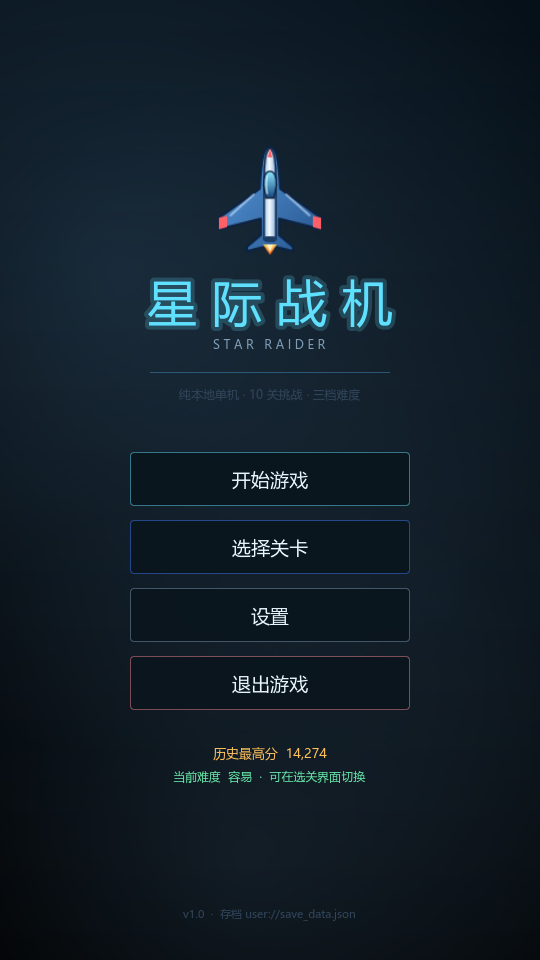
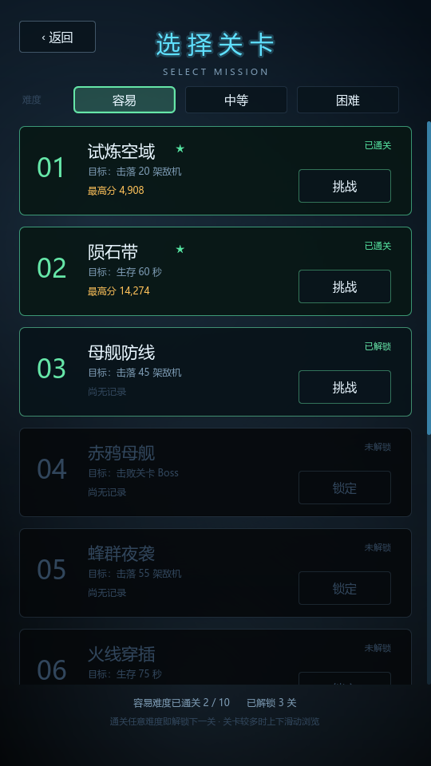
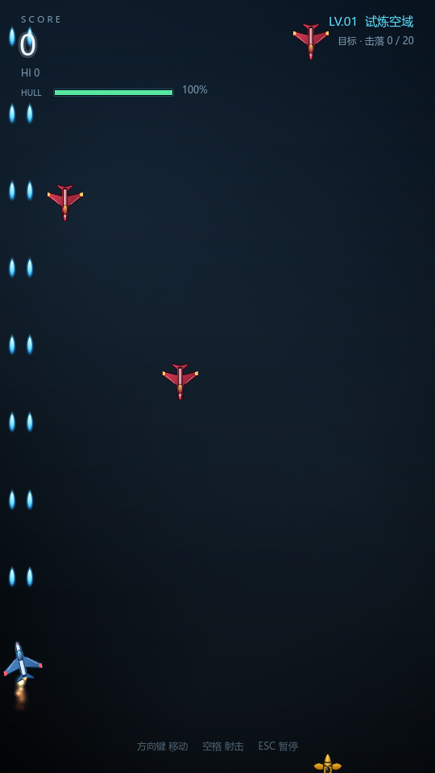
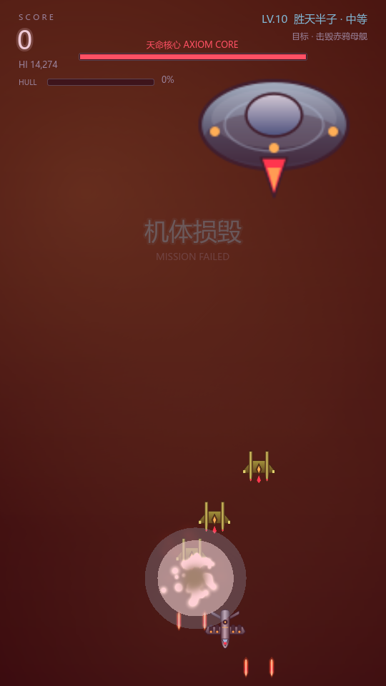
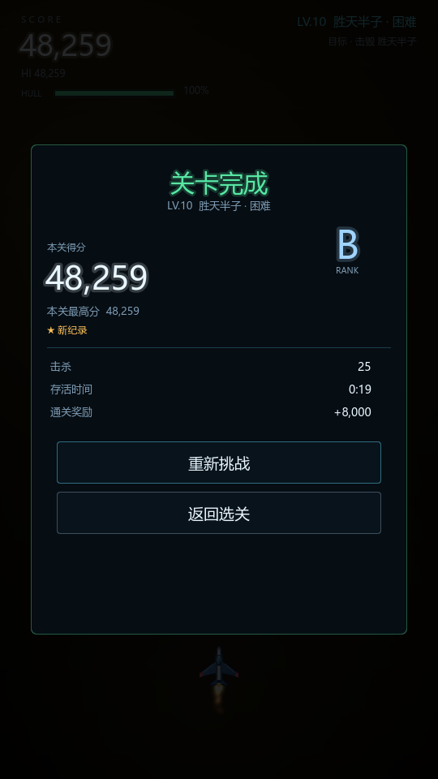

# 星际战机 · Star Raider

一款纯本地单机的竖版飞行射击游戏（STG），使用 **Godot 4** 开发。无联网、无内购、无广告——打开即玩，进度自动保存在本地。

- 10 个手工调优的关卡，含 3 场多阶段 Boss 战
- 每关可选 **容易 / 中等 / 困难** 三档难度，记录独立保存
- 全部关卡、敌人、子弹、难度均为 **JSON 数据驱动**，不写代码即可加关
- 540×960 竖屏，键盘操作，60 FPS

## 游戏截图

| 主菜单 | 选关（三档难度） | 战斗 |
|---|---|---|
|  |  |  |

| Boss 战 | 通关结算 |
|---|---|
|  |  |

## 操作说明

| 按键 | 功能 |
|---|---|
| 方向键 / WASD | 移动 |
| 空格 | 射击（可按住连发） |
| ESC | 暂停 / 返回 |

## 运行方式

需要 **Godot 4.7+**（开发版本为 4.7.2，渲染管线为 GL Compatibility）：

```bash
# 克隆后直接用 Godot 打开项目目录即可
godot --path .
```

或在 Godot 编辑器中「导入」本目录的 `project.godot`，按 F5 运行。首次启动会自动导入资源。

## 关卡与难度

| # | 名称 | 目标 | Boss |
|---|---|---|---|
| 01 | 试炼空域 | 击落 20 | — |
| 02 | 陨石带 | 生存 60s | — |
| 03 | 母舰防线 | 击落 45 | — |
| 04 | 赤鸦母舰 | 击败 Boss | 赤鸦母舰（3 阶段） |
| 05 | 蜂群夜袭 | 击落 55 | — |
| 06 | 火线穿插 | 生存 75s | — |
| 07 | 幻影坟场 | 击落 60 | — |
| 08 | 王座前哨 | 击落 70 | — |
| 09 | 残响要塞 | 击败 Boss | 骸翼巡航舰（3 阶段） |
| 10 | **胜天半子** | 击败 Boss | 天命核心（5 阶段终局战） |

三档难度在敌机血量 / 移速 / 刷怪密度 / 开火频率 / 弹速 / Boss 强度 / 玩家承伤 / 得分系数八个维度上同时调整：

| | 容易 | 中等 | 困难 |
|---|---|---|---|
| 敌机血量 | ×0.7 | ×1.0 | ×1.45 |
| 刷怪间隔 | ×1.30 | ×1.0 | ×0.78 |
| Boss 血量 | ×0.70 | ×1.0 | ×1.50 |
| 玩家承伤 | ×0.70 | ×1.0 | ×1.25 |
| 得分系数 | ×0.80 | ×1.0 | ×1.25 |

任意难度通关即解锁下一关；每个难度独立记录最高分与通关状态（选关界面可随时切换查看）。

## 数据驱动设计

游戏内容几乎全部由 JSON 描述，改数值、加内容都不需要碰代码：

```
data/
├── bullets.json        # 子弹定义（贴图、半径、颜色）
├── enemies.json        # 10 种敌机（血量、移速、移动模式、开火方式、分值）
├── difficulties.json   # 三档难度倍率
└── levels/
    ├── level_01.json   # 目标、敌人池、刷怪曲线、属性倍率、波次表、背景色调
    └── ...             # level_02 ~ level_10
```

**加一关**只需新建 `data/levels/level_11.json`：配置目标（击落数 / 生存时间 / Boss）、敌人池与权重、刷怪间隔曲线、波次表，可选 Boss 多阶段（血量分段 + 每段攻击模式 + 移速）。选关界面、解锁进度、存档会自动识别。

敌机攻击方式包括：直射、扇形散射、追踪弹、预警激光、环形弹幕；移动模式包括直线、蛇形、悬停、折返等，均可在 JSON 中组合。

## 项目结构

```
├── project.godot           # 工程配置（主场景、Autoload、输入映射）
├── assets/                 # SVG 美术资源 + 程序生成的 WAV 音频
├── data/                   # 全部玩法数据（JSON）
├── scenes/                 # .tscn 场景（主菜单 / 选关 / 战斗 / HUD / 实体）
├── scripts/
│   ├── autoload/           # SaveManager / AudioManager / GameState
│   ├── entities/           # 玩家、敌机、Boss、子弹
│   ├── fx/                 # 星空背景、爆炸粒子
│   ├── ui/                 # HUD、主菜单、选关
│   ├── game.gd             # 战斗主控制器（刷怪、波次、计分、结算）
│   └── level_data.gd       # JSON 数据加载层
└── tools/                  # 开发期截图自查工具（不参与游戏流程）
```

## 存档说明

存档为单个 JSON 文件（Windows 下位于 `%APPDATA%/Godot/app_userdata/星际战机 Star Raider/save_data.json`），包含：

- `unlocked_level`：已解锁关卡
- `level_records`：按关卡 × 难度分别记录最高分与通关状态
- `settings`：音乐 / 音效音量、音效开关、屏幕震动开关

存档损坏时自动回退默认值；旧版本存档格式会自动迁移。设置界面提供「重置存档」（二次确认）。

## 技术要点

- **Godot 4.7 / GDScript**，GL Compatibility 渲染管线，低配置机器可流畅运行
- 全部美术为矢量 SVG，全部音效与 BGM 为**程序合成**的 WAV（仓库内无第三方素材，无版权风险）
- 物理回调内的碰撞体创建统一走 `call_deferred`，避免引擎 flush 报错
- `tools/screenshot.gd` 支持 `--scene / --level / --difficulty / --hold / --click / --killall / --god / --wait / --out` 参数，可 headless 复现任意游戏状态并截图，本 README 的截图均由它产出

## 更新日志

- **v1.0.1**：修复带预警激光的敌机被击毁 / 撞毁时，无限循环 Tween 在已释放节点上持续步进导致的「受击后卡死」。
- **v1.0.0**：首个正式版本，10 关 / 三档难度 / 3 场多阶段 Boss 战。

## 开源协议

MIT License
